# Adil Mohammed Shajahan

**AI / ML Engineer** · Computer Vision · NLP · LLM Systems

I build practical AI systems: local multimodal RAG, real-time computer vision, and NLP models. Below is a selection of my work.

---

## Featured Projects

| Project | What it does | Stack |
| --- | --- | --- |
| [**Paper Element Retriever**](https://github.com/4M5/paper-element-retriever) | Fully local multimodal RAG for research PDFs. Text, tables and figures share one index. Figures are described by a vision model. Answers carry citations and are scored by an LLM-as-a-Judge check. | Python, FastAPI, Ollama, LLaMA 3.1, LLaVA, ChromaDB, LangChain |
| [**Gesture Virtual Mouse**](https://github.com/4M5/Virtual-Mouse-Gesture) | Hands-free computer control by gesture, eye tracking or voice. Runs in real time at 25 FPS with no extra hardware. | Python, OpenCV, MediaPipe, PyAutoGUI |
| **RAT-SQL Text-to-SQL** | RAT-SQL implemented and trained on Spider. 61.3% exact-match on easy-tier queries. Error analysis shows schema linking and value alignment as the main failure modes. | Python, PyTorch, Hugging Face |
| **Exam Behavior Anomaly Detection** | Isolation Forest over 12 behavioral features (keystrokes, tab switching, paste events). Gemini explains each flagged session. Built for the IIT Palakkad hackathon. | Python, Scikit-learn, Flask, Gemini API |

---

## Tech Stack

| Area | Tools |
| --- | --- |
| Languages | Python, C |
| ML / DL | PyTorch, TensorFlow, Scikit-learn, Hugging Face Transformers, OpenCV, MediaPipe |
| LLM / GenAI | RAG, LangChain, Ollama, Gemini API, Agentic AI, n8n |
| Backend / Tools | FastAPI, Flask, MySQL, ChromaDB, Docker, Git, MQTT |

---

  <picture>
    <source media="(prefers-color-scheme: light)" srcset="https://raw.githubusercontent.com/4M5/4M5/output/snake-light.svg">
    
  </picture>

<!-- Snake is generated daily by .github/workflows/snake.yml -->
